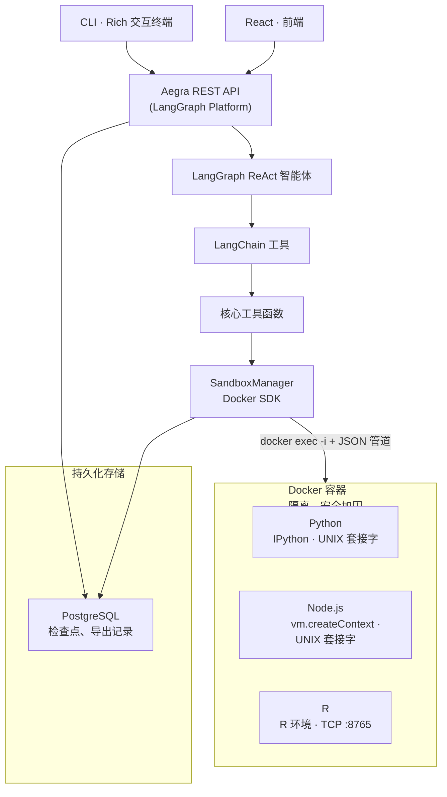
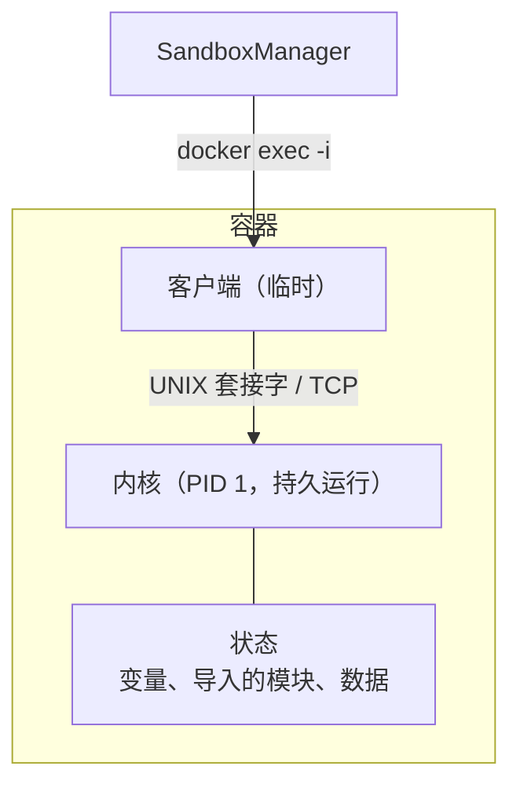

# TaskHarbor

支持异步多智能体协作的任务执行平台，基于 LangGraph 与 Deep Agents 构建，提供任务委派、工具审批、上下文管理与持久化产物交付，并通过 Docker 沙箱执行代码。每个会话运行在独立且经过安全加固的 Docker 容器中，并使用持久内核：Python 使用 IPython，Node.js 使用 `vm.createContext`，R 使用专用的 R 环境。支持三种运行时、与供应商无关的 LLM 配置，以及视觉能力（自动检测多模态模型）。提供交互式 CLI、REST API（基于 [Aegra](https://aegra.dev/)）和 React 前端。

## 功能特性

- **Docker 隔离** — 每个会话使用独立容器，不暴露端口，仅挂载后端管理的独立工作区和只读上传目录
- **容器安全加固** — 非 root 用户（UID 65532）、PID 限制、内存与交换空间限制、持久工作区与临时目录分离，以及 `no-new-privileges`
- **崩溃检测** — 检测 OOM 终止、fork 炸弹和段错误，并向智能体清晰报告
- **持久状态** — 多次代码执行之间保留变量，类似 Jupyter 单元格
- **PostgreSQL 检查点存储** — 重启后仍保留对话历史，与 Aegra 共用
- **异步支持** — 自动等待 Node.js Promise 和 Python 协程完成
- **多运行时** — Python、Node.js 和 R
- **富媒体输出** — 捕获 matplotlib/ggplot 图像、Plotly 图表、IPython Audio、HTML 组件等，并自动将图像发送给多模态 LLM
- **与供应商无关** — 通过 `langchain init_chat_model` 支持 OpenAI、Anthropic、Google Gemini、Ollama 或其他兼容供应商
- **运行时安装依赖** — 创建会话时或通过终端执行 `pip install`、`npm install`、`install.packages()`
- **六个工具** — `create_session`、`execute_code`、`execute_terminal`、`import_files`、`export_files`、`stop_session`
- **异步子任务** — 接入 Deep Agents 的 `start_async_task`、`check_async_task`、`update_async_task`、`cancel_async_task` 和 `list_async_tasks`。启动后立即返回任务 ID，主 Agent 继续工作。默认最多 3 个 worker，各自使用独立容器、内核、工作目录和 checkpoint。
- **子任务审批** — 主、子任务的审批可独立处理；本轮内等待用户决定，最终汇总前收齐结果。中间文件临时交接到主沙箱，只有最终文件需要发布。
- **REST API** — 通过 [Aegra](https://aegra.dev/) 提供完整的 LangGraph Platform API，支持 OpenAPI 文档、流式输出和对话线程管理
- **输入校验** — 执行前使用 Pydantic 模型校验所有工具输入，失败时返回结构化错误
- **React 前端** — 单页应用，支持聊天、工具可视化、文件上传下载和设置对话框（React 19 + Vite + Tailwind CSS）
- **文件上传** — 将文件上传至 API，以便导入沙箱会话（`POST /threads/{id}/files/upload`）
- **文件导出** — 发布独立持久副本；通过 API 下载或用于跨会话导入，容器回收后仍可用
- **文件导入** — 支持宿主机路径、内联内容，或其他会话中已在同一对话内导出的文件
- **跨会话传输** — 从会话 A 导出，再使用 `{session_id, path}` 导入会话 B
- **会话垃圾回收** — 支持温池空闲淘汰、活跃执行保护、安全轮换和归属可验证的孤立容器清理
- **自动清理** — 管理器退出时停止并删除自己管理的容器，保留持久数据

## 环境要求

子任务默认启用，可通过 `SUBAGENTS_ENABLED=false` 关闭。并发、每轮总任务数、整任务期限和图执行步数分别由 `SUBAGENT_MAX_CONCURRENCY`、`SUBAGENT_MAX_TASKS_PER_RUN`、`SUBAGENT_TIMEOUT_SECONDS`、`SUBAGENT_MAX_STEPS` 控制；等待审批仍占 worker 名额。

主 Agent 和子 Agent 分别通过 checkpoint 中断与恢复处理审批。主聊天聚合相关审批，决定和恢复路由到实际执行 thread。一个子任务等待审批时，主 Agent 和其他子任务可以继续工作。

子任务通过 Aegra 独立 thread 和后台 run 执行。主图等待结果时保存业务等待 checkpoint，服务在结果齐备后恢复主图汇总。重启后保留 checkpoint 和工作区，遗留执行会记录中断信息，供主 Agent 判断后续处理。文件输入通过 `prepare_task_files` 生成授权清单，由 worker 的 `import_task_files` 接收。主 Agent 用 `collect_task_files` 收取选定产物，再导出最终文件。

API 服务通过 `SUBAGENT_PROTOCOL_URL` 访问内部协议端点，默认使用 `API_BASE_URL` 下的 `/internal/subagents`。独立 worker 依赖 Aegra 服务与 PostgreSQL。审批暂停保留任务名额，执行期限覆盖审批等待。

- Python 3.11+
- Docker Engine
- LLM 供应商的 API 密钥（`CHAT_MODEL_API_KEY`）
- PostgreSQL（API/CLI 模式使用，供检查点存储和 Aegra 使用）
- Node.js 18+ 和 npm（用于 React 前端）

## 安装配置

```bash
# Docker：按需安装、配置权限，并构建全部三种镜像
sudo ./setup-docker.sh

# 安装 Python 依赖（打开新终端，使 docker 用户组生效）
uv sync

# 安装前端依赖
cd frontend && npm install && cd ..

# 配置环境
cp .env.example .env
# 编辑 .env，填写 CHAT_MODEL_API_KEY、POSTGRES_PASSWORD 及其他设置

# 若镜像尚不存在，首次使用时也会自动构建 Docker 镜像
```

### PostgreSQL（CLI、API 和 UI 必需）

使用 `localhost` 时，PostgreSQL 会通过 Docker Compose 自动启动。CLI 会检测 PostgreSQL 是否可访问，并在需要时自动启动：

```bash
# 按需手动启动
docker compose up postgres -d
```

也可以通过 `.env` 中的 `POSTGRES_*` 环境变量连接现有 PostgreSQL 实例。

## 使用方法

所有命令统一使用 `taskharbor` 入口：

```bash
uv run taskharbor cli       # 交互式 CLI（默认）
uv run taskharbor api       # REST API（Aegra，不自动重载）
uv run taskharbor api dev   # 支持热重载的 REST API
uv run taskharbor ui        # React UI（按需自动启动 API）
```

### CLI

```bash
uv run taskharbor cli
# 也可以直接运行
uv run taskharbor
```

CLI 是基于 Aegra REST API 的轻量客户端，需要先运行 API（`uv run taskharbor api`）。功能包括：

- 使用 [Rich](https://github.com/Textualize/rich) 面板展示工具输入输出，并按运行时进行语法高亮
- 流式显示智能体输出，支持 Markdown 渲染
- 重启后保留对话线程（`~/.local/state/taskharbor/cli-thread.json`）
- 使用 `/new` 命令开始新对话
- 通过 `configurable` 向 API 传递模型、供应商和密钥设置

### REST API（Aegra）

通过 [Aegra](https://aegra.dev/)（可自行托管的 LangGraph Platform 替代方案）将智能体作为 REST API 运行：

```bash
uv run taskharbor api       # 生产模式（不重载，自动启动 PostgreSQL）
uv run taskharbor api dev   # 开发模式（通过 aegra dev 热重载）
```

生产模式命令会在本机 PostgreSQL 不可访问时，通过 Docker Compose 自动启动它。服务地址为 `http://localhost:8000`，OpenAPI 文档位于 `/docs`。可使用 LangGraph SDK 或 curl 创建助手、对话线程，并以流式方式运行。兼容 Agent Chat UI、LangGraph Studio 和 CopilotKit。

`api dev` 同样先检查配置中的 PostgreSQL 地址；已有数据库可达时直接复用，不要求它属于本项目的 Compose 容器。检查通过后使用 `aegra dev --no-db-check`，避免重复启动容器造成 5432 端口冲突。应用默认从项目根目录加载 `.env`，API 子进程也在根目录启动；环境变量仍优先于文件配置。Windows 前端启动会解析 `npm.cmd`。

自定义接口：

- `GET /threads/{thread_id}/files/download?session_id=...&path=...` — 下载已持久发布的文件（不依赖存活容器）
- `POST /threads/{thread_id}/files/upload` — 上传文件，供后续导入沙箱会话
- `DELETE /threads/{thread_id}` — 通过中间件同时清理该线程的 Docker 会话和存储
- `GET /settings` — 返回持久化的前端设置，覆盖后端 `.env` 中的默认设置
- `PUT /settings` — 将前端设置加密后持久保存至 PostgreSQL

### React 前端

通过 Aegra API 与智能体聊天的 Web 界面（React 19 + Vite + Tailwind CSS）：

```bash
# 安装前端依赖（如果安装配置阶段尚未执行）
cd frontend && npm install && cd ..

# 启动 UI（按需自动启动 API 和 PostgreSQL）
uv run taskharbor ui
```

前端运行在 `http://localhost:5173`（Vite 开发服务器，将 API 请求代理至 `:8000`）。功能包括：

- 通过侧边栏管理对话线程：创建、恢复和删除对话
- 流式响应，支持展开工具调用块，并按运行时进行语法高亮
- 文件上传和下载
- 思考内容块可视化
- 设置对话框：模型、供应商、API 密钥、基础 URL、视觉能力开关
- 通过服务端 API（`GET/PUT /settings`）持久保存设置，未设置时使用后端 `.env` 默认值

### 在代码中调用

```python
from taskharbor.sandbox import SandboxManager

manager = SandboxManager()

info = manager.create_session(
    runtime="python",
    dependencies={"pandas": "2.2.3", "matplotlib": ""},
)
sid = info.session_id

r1 = manager.execute_code(sid, """
import pandas as pd
df = pd.DataFrame({'x': [1, 2, 3], 'y': [4, 5, 6]})
print(df.describe())
""")
print(r1.stdout)

# 多次调用之间保留变量
r2 = manager.execute_code(sid, "df.shape")
print(r2.result)

# 从沙箱导出文件（发布持久副本）
manager.execute_code(sid, "df.to_csv('/workspace/output.csv', index=False)")
export = manager.export_files(sid, [{"source": "output.csv"}])
print(export.files[0].session_id, export.files[0].path)

manager.stop_session(sid)
```

#### 导出文件

`export_files` 发布独立副本以供下载和跨会话导入，结果在容器外持久保存。文件可通过 API（`GET /threads/{thread_id}/files/download?session_id=...&path=...`）访问，也可在其他会话中通过 `import_files` 导入：

```python
# 导出单个文件
result = manager.export_files(sid, [{"source": "report.pdf"}])

# 导出整个目录
result = manager.export_files(sid, [{"source": "results/"}])

# 一次导出多个文件
result = manager.export_files(sid, [
    {"source": "data.csv"},
    {"source": "chart.png"},
    {"source": "/workspace/logs/"},
])

for f in result.files:
    print(f"{f.session_id}:{f.path} ({'OK' if f.success else f.error})")
```

#### 跨会话文件传输

结合 `export_files` 和 `import_files`，可在会话之间传输文件，也支持不同运行时之间传输：

```python
# 会话 A（Python）：生成数据
sid_a = manager.create_session(runtime="python", dependencies={"pandas": ""}).session_id
manager.execute_code(sid_a, """
import pandas as pd
df = pd.DataFrame({'x': [1,2,3], 'y': [4,5,6]})
df.to_csv('/workspace/data.csv', index=False)
""")
export = manager.export_files(sid_a, [{"source": "data.csv"}])
path = export.files[0].path  # /workspace/data.csv

# 会话 B（R）：使用同一份数据
sid_b = manager.create_session(runtime="r", dependencies={"readr": ""}).session_id
manager.import_files(sid_b, [{"session_id": sid_a, "path": path, "destination": "data.csv"}])
manager.execute_code(sid_b, 'df <- readr::read_csv("/workspace/data.csv"); summary(df)')
```

#### 导入文件

`import_files` 将宿主机或其他会话中的文件复制到沙箱：

```python
# 从宿主机导入
result = manager.import_files(sid, [
    {"source": "/home/user/data.csv", "destination": "data.csv"},
    {"source": "/home/user/project/", "destination": "project/"},
])

# 从其他会话导入（文件必须已导出）
result = manager.import_files(sid, [
    {"session_id": "abc123", "path": "/workspace/out.csv", "destination": "out.csv"},
])
```

其他运行时的使用方式相同，在调用 `create_session` 时传入 `runtime="node"` 或 `runtime="r"` 即可。

### 异步代码

**Node.js** — 如果最后一个表达式返回 Promise，内核会等待其完成后再收集输出。也支持顶层 `await`，必要时会回退到异步立即调用函数表达式（IIFE）包装。

```javascript
const axios = require('axios');
async function fetchData() {
    const resp = await axios.get('https://api.example.com/data');
    console.log(resp.data);
}
fetchData(); // 自动等待 Promise 完成
```

**Python** — IPython 的 `autoawait` 处理顶层 `await`。如果单元格返回未被等待的协程，内核会检测到它，并通过 `asyncio.run()` 执行。

```python
import aiohttp

async def fetch_data():
    async with aiohttp.ClientSession() as session:
        resp = await session.get('https://api.example.com/data')
        print(await resp.text())

fetch_data()  # 自动检测并执行协程
```

## 工具确认与 Windows 本机命令

Agent 工具支持允许/禁止规则、工具自身检查和用户确认，不使用额外审查模型。审批按模型调用顺序逐条展示，保存决定后立即推进下一条；已获批的独立工具可并发执行，默认最多 4 个。刷新后仍可恢复，恢复不重复已完成的操作；整批结果齐后再交给模型。

Windows 本机命令默认关闭。在 `.env` 设置 `HOST_COMMANDS_ENABLED=true` 并重启后端，Agent 才会获得 `execute_host_command`；它使用 PowerShell，每次执行都要确认。现有 `execute_terminal` 继续在 Docker 内执行。本机命令使用当前 Windows 账号权限，工作目录不构成文件访问隔离。

审批记录通过 PostgreSQL 持久化；恢复操作使用已保存的决定。执行结果未知时不自动重试，避免重复副作用。

## 容器安全

每个容器创建时均配置以下保护措施：

| 保护措施 | 设置 | 效果 |
|---|---|---|
| 内存限制 | `2048m`（不使用交换空间） | 超限时触发 OOM 终止，不影响宿主机 |
| PID 限制 | `512` | 限制并终止 fork 炸弹 |
| CPU 配额 | `2` 核 | 防止耗尽宿主机 CPU 资源 |
| 可写目录 | tmpfs（`/tmp`、`/home/sandbox`；`/workspace` 为受控持久目录） | tmpfs 目录不写入宿主机磁盘 |
| tmpfs 大小 | 每个挂载点 `200m` | 限制容器内存储用量 |
| 用户 | `sandbox`（UID 65532） | 容器内不使用 root 用户 |
| 权限 | `no-new-privileges` | 无法通过 setuid/setgid 提权 |
| 网络 | 可配置，默认启用 | 可按会话禁用 |

容器崩溃时，智能体会收到明确的 `CONTAINER_DIED` 错误，其中包含原因（OOM 终止、SIGKILL、段错误等）以及重新创建会话的提示。

## 会话生命周期

通过垃圾回收机制自动管理会话：

| 行为 | 默认值 | 设置项 |
|---|---|---|
| 空闲超时 | 10 分钟 | `SESSION_IDLE_TTL_SECONDS` |
| 环境轮换年龄 | 2 小时 | `SESSION_MAX_LIFETIME_SECONDS` |
| 垃圾回收间隔 | 60 秒 | `SESSION_GC_INTERVAL_SECONDS` |
| 容量等待期限 | 30 秒 | `SANDBOX_QUEUE_TIMEOUT_SECONDS` |
| 全局最大会话数 | 5 | `CONTAINER_MAX_SESSIONS` |
| 每个线程的最大会话数 | 3 | `CONTAINER_MAX_SESSIONS_PER_THREAD` |
| 孤立容器清理的最小存活时间 | 5 分钟 | `CONTAINER_ORPHAN_MIN_AGE_SECONDS` |

启动时，仅清理属于当前存储部署、管理心跳已失效且达到最小年龄的容器。退出时清理本管理器的容器；工作文件与已发布成果不随容器删除。

## 配置

所有设置均可通过环境变量或 `.env` 覆盖。以下展示 `settings.py` 中的默认值：

```bash
# ── LLM（与供应商无关）──
CHAT_MODEL=gpt-4o                    # 模型名称
CHAT_MODEL_PROVIDER=openai           # 供应商：openai、anthropic、google_genai、ollama
CHAT_MODEL_API_KEY=sk-...            # API 密钥（必填）
CHAT_MODEL_BASE_URL=                 # 自定义 API 基础 URL（可选）
CHAT_MODEL_SUPPORTS_VISION=          # 覆盖视觉检测结果（true/false，留空表示自动）

# ── 容器限制 ──
CONTAINER_MEMORY_LIMIT=2048m         # Docker 内存限制（无交换空间）
CONTAINER_CPU_QUOTA=200000           # CPU 配额（100000 = 1 核）
CONTAINER_PIDS_LIMIT=512             # 每个容器的最大 PID 数
CONTAINER_TMPFS_SIZE=200m            # 可写目录的 tmpfs 大小
CONTAINER_EXECUTION_TIMEOUT_SECONDS=30  # 默认代码执行超时，单位为秒
CONTAINER_MAX_SESSIONS=5             # 全局最大并发会话数
CONTAINER_MAX_SESSIONS_PER_THREAD=3  # 每个对话的最大会话数
CONTAINER_EXECUTE_AS_ROOT=False      # 是否以 root 身份执行终端命令
CONTAINER_NETWORK_ENABLED=True       # 启用容器网络（可按会话禁用）
CONTAINER_ORPHAN_MIN_AGE_SECONDS=300 # 清理孤立容器的最小存活时间（5 分钟）

# ── 会话生命周期 / 垃圾回收 ──
SESSION_IDLE_TTL_SECONDS=600        # 空闲超时（10 分钟）
SESSION_MAX_LIFETIME_SECONDS=7200    # 环境轮换年龄（活跃任务完成后回收）
SESSION_GC_INTERVAL_SECONDS=60       # 垃圾回收检查间隔
SESSION_MAX_ACTIVE_THREADS=10        # 旧兼容配置，不再按对话数淘汰文件

# ── 输出截断（字符数）──
MAX_STDOUT_CHARS=50000
MAX_STDERR_CHARS=120000
MAX_RESULT_CHARS=30000
MAX_TRACEBACK_CHARS=8000

# ── 加密 ──
ENCRYPTION_KEY=                      # 用于设置加密的 Fernet 密钥（可选）

# ── 存储 ──
STORAGE_DIR=./storage                # 上传文件的基础目录
IMPORT_ALLOWED_DIRS=                 # 额外允许导入的宿主机目录，逗号分隔（留空仅允许当前归属目录）

# ── API ──
API_BASE_URL=http://127.0.0.1:8000   # API URL（用于生成导出下载 URL）

# ── 智能体 ──
MAX_ITERATIONS=25                    # LangGraph 最大迭代次数（递归限制）

# ── PostgreSQL（检查点存储 + Aegra）：全部必填，无默认值 ──
POSTGRES_USER=taskharbor
POSTGRES_PASSWORD=taskharbor_secret
POSTGRES_DB=taskharbor
POSTGRES_HOST=localhost
POSTGRES_PORT=5432
```

## 运行时

| 运行时 | 基础镜像 | 内核 | 进程间通信（IPC） | 预装依赖 |
|---|---|---|---|---|
| Python | `python:3.12-slim` | IPython shell | UNIX 套接字 | IPython 和系统库 |
| Node.js | `node:22-slim` | `vm.createContext` | UNIX 套接字 | 仅基础运行时 |
| R | `rocker/r-ver:4` | 专用 R 环境 | TCP `:8765` | jsonlite、base64enc、tidyverse、data.table、readxl、haven、httr2、DBI、RSQLite、rmarkdown、knitr、devtools、glmnet、randomForest |

R 容器使用编译后的 C 客户端二进制程序进行 IPC，Python 和 Node.js 则使用各自语言实现的客户端。

## 架构



在每个容器内部，持久运行的**内核**（PID 1）保存执行状态。每次调用 `docker exec` 时，都会启动一个临时**客户端**，通过 UNIX 套接字（Python/Node.js）或 TCP（R）连接内核：



## 测试

工具中断后，下一次模型请求会临时补齐缺失的工具响应，以便继续对话；补齐内容说明结果未收到，并且不会写入 state 或 checkpoint。前端按工具所属的 Aegra run 查询状态，支持刷新后恢复状态并停止运行。没有 run 信息的历史调用显示 `Result unknown`。取消 run 不保证已经进入 Docker 的同步操作停止，重试有副作用的操作前应检查实际状态。

```bash
# 中断恢复测试（无需 Docker 或 LLM）
uv run pytest tests/test_tool_recovery.py -v

# 前端状态和 API 测试（Node.js 22.6+，使用内置 TypeScript 类型剥离）
cd frontend
npm test
cd ..

# 单元测试（无需 Docker）
uv run pytest tests/test_cli.py tests/test_http_app.py -v

# 集成测试（需要 Docker）
uv run pytest tests/test_manager.py tests/test_tools.py tests/test_export_files.py tests/test_mcp.py -v

# LangGraph 调试跟踪（需要 Docker 和 LLM API 密钥）
uv run pytest tests/test_langgraph_debug.py -v -s

# API 集成测试（需要 Docker，并先运行 API：uv run taskharbor api dev）
uv run pytest tests/test_api.py -v -s

# 全量测试
uv run pytest tests/ -v
```

## 生产部署

项目包含用于生产部署的 `Dockerfile` 和 `docker-compose.yml`：

```bash
# 启动 PostgreSQL 和 API
docker compose up -d

# 或手动构建并运行
docker build -t taskharbor-api .
docker run -p 8000:8000 --env-file .env taskharbor-api
```

生产镜像以非 root 的 `app` 用户运行 `aegra serve`。

## 许可证

[MIT](LICENSE) — Eduardo Ramon Resser

## 沙箱生命周期改造

执行环境采用按对话和运行时复用的温池；文件独立持久保存，已发布结果在容器回收后仍可下载。

当前沙箱调度器面向单后端管理进程，同一存储目录不支持多个 API worker 同时调度。容器回收保留工作区文件，但不恢复内核变量或后台进程。持久目录需要独立配置磁盘配额与监控。
